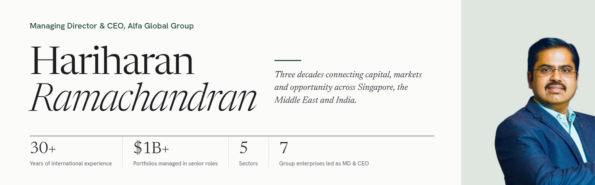

  

# Hariharan Ramachandran

**Managing Director & CEO, Alfa Global Group**
Singapore · Middle East · India

> *“Capital moves across borders. Sound judgment connects the dots.”*

Three decades connecting capital, markets and opportunity across Singapore, the Middle East and India. Today, Hariharan leads Alfa Global Group as it builds and scales enterprises across seven sectors.

| 30+ | $1B+ | 5 | 7 |
| :-- | :-- | :-- | :-- |
| Years of international experience | Portfolios managed in senior roles | Sectors, one considered perspective | Group enterprises led as MD & CEO |

---

## The perspective

Hariharan's career spans fund management, portfolio construction, capital markets and financial analysis. Over three decades he has worked across international investment firms and corporate institutions, building a comprehensive perspective on global capital allocation.

Experience across technology, financial services, healthcare, oil & gas and real estate informs how he assesses opportunities, understands risk and contributes to institutional decision-making.

Today he brings that perspective to Alfa Global Group as Managing Director and CEO, guiding a family of enterprises from maritime and agriculture to financial technology and cyber security.

## Areas of expertise

*Research-led thinking. Disciplined execution. An institutional point of view.*

- **Portfolio construction.** Structuring investment funds and portfolios with disciplined capital deployment and a clear understanding of risk.
- **Investment research.** Connecting financial analysis, capital markets research and macro-financial frameworks to investment decisions.
- **Risk & governance.** Institutional perspective on risk assessment, regulatory alignment and international compliance frameworks.
- **Strategic advisory.** Governance-level insights that inform strategic planning, market positioning and long-term capital allocation.

## Alfa Global Group

A diversified strategic investment and holding company that builds, acquires and scales enterprises in agriculture, maritime, infrastructure and technology. Headquartered in Nanganallur, Chennai, the group pairs long-term capital with operating partners and disciplined governance.

Present roles across the group, as listed on [alfaglobalwealth.com](https://www.alfaglobalwealth.com):

| Enterprise | Sector | What it does |
| :-- | :-- | :-- |
| [Alfa Global Wealth Advisors](https://www.alfaglobalwealth.com/alfa-global-wealth-advisors) | Family office | The family office of Alfa Global Group. |
| [Alfa Star Dynamics](https://www.alfaglobalwealth.com/alfa-star-dynamics) | Strategic holdings | Takes long-term stakes in maritime and industrial businesses alongside operating and industry partners. |
| [Alfa Zillion Traders](https://www.alfaglobalwealth.com/alfa-zillion-traders) | Financial technology | Builds in-house fintech platforms and quantitative tools, trading only on its own account. |
| [Gazillion Capital](https://www.alfaglobalwealth.com/gazillion-capital) | Financial services | A separately operated financial services company, with its own management and governance, focused on financial literacy. |
| [Dhanveir Groups Shipping](https://www.alfaglobalwealth.com/dhanveir-groups-shipping) | Maritime | Set up to build, own and operate Indian-flagged vessels across key cargo segments, including dry bulk. |
| [MK Dairy Farms](https://www.alfaglobalwealth.com/mk-dairy-farms) | Agriculture | Links quality produce with established markets and supports rural economies. |
| [Cyberhakz](https://www.alfaglobalwealth.com/cyberhakz) | Cyber security | Enterprise-grade protection against digital threats, from infrastructure security to regulatory compliance. |

## Professional journey

*Leadership across international investment management and corporate advisory.*

**Managing Director & CEO — Alfa Global Group**
India · Present
Leads a diversified strategic investment and holding company, headquartered in Chennai, that builds, acquires and scales enterprises across agriculture, maritime, infrastructure, technology and financial services. *Seven group enterprises.*

**Principal Fund Manager — Eurostar Group & Family Offices**
Middle East · Family offices
Senior investment leadership with responsibility for portfolios in excess of USD 1 billion, spanning portfolio structuring, investment research, risk assessment and capital deployment. *USD 1B+ portfolios.*

**Principal Fund Manager — Avici Investments Pte Ltd**
Singapore · Fund management
Fund management and corporate advisory at the Singapore-based firm promoted by GR Visions Pte Ltd and TANO Capital LLC, an affiliate of Franklin Templeton. *Corporate advisory.*

**Institutional & regulatory experience — International**
Middle East, Singapore, Malaysia · Governance
Engagements involving DFSA-regulated entities in the Middle East and companies in Singapore and Malaysia, supporting familiarity with international compliance and institutional governance. *DFSA-regulated entities.*

## Advisory & governance

**Advisory Board member.** Contributing to the advisory boards of SEBI-registered Alternative Investment Funds, including the **Bharat Heritage Asset Fund**, with insights into investment strategy, governance and market positioning.

## How he works

| Discipline | Perspective | Purpose |
| :-- | :-- | :-- |
| Research-led thinking and disciplined execution, with risk understood before capital is committed. | Three decades across markets, sectors and regulatory regimes, brought to every decision. | An institutional point of view focused on long-term capital allocation and sound governance. |

## Experience with

Alfa Global Group · Eurostar Group · Avici Investments · Bharat Heritage Asset Fund · DFSA-regulated entities

## Let's connect

A meaningful conversation is a good place to begin. For professional connections and investment advisory conversations:

- **Email:** [hari@hariharan.biz](mailto:hari@hariharan.biz)
- **Telephone:** [+91 73580 65999](tel:+917358065999)
- **LinkedIn:** [Hariharan Ramachandran](https://www.linkedin.com/in/hariharan-ramachandran-4285b23b)
- **Contact card:** [hariharan-ramachandran.vcf](https://www.hariharan.biz/hariharan-ramachandran.vcf)
- **Based in:** Chennai, India (IST, UTC+5:30)

---

Professional profile. Content does not constitute investment advice. © 2026 Hariharan Ramachandran.
